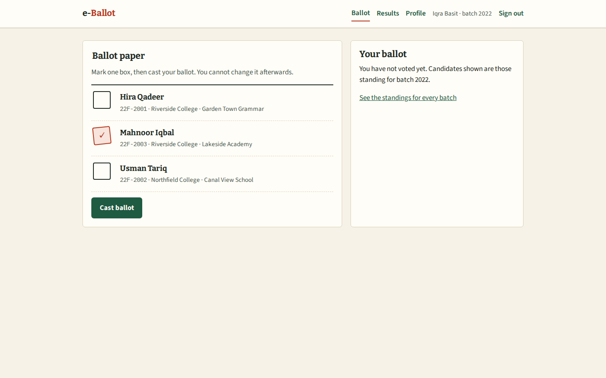
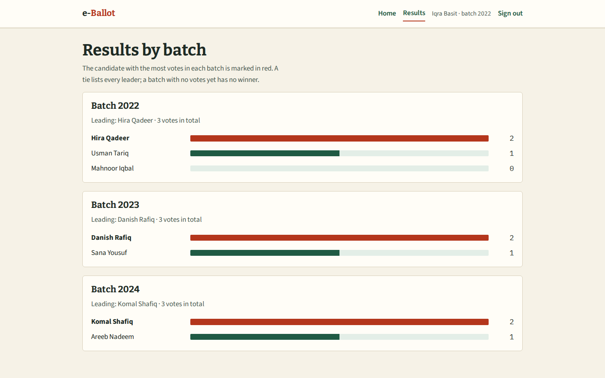
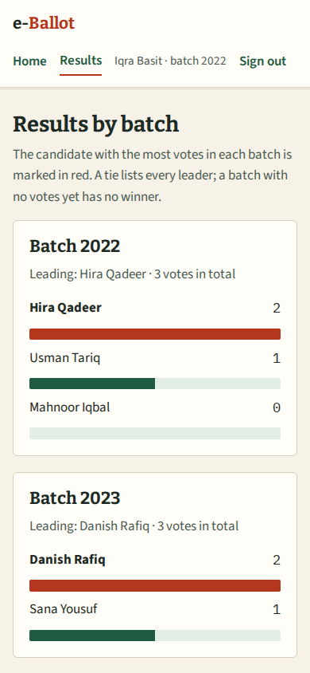
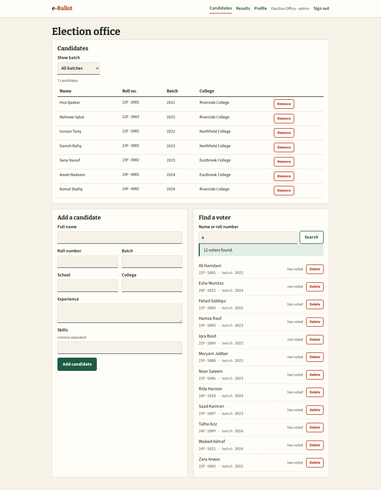
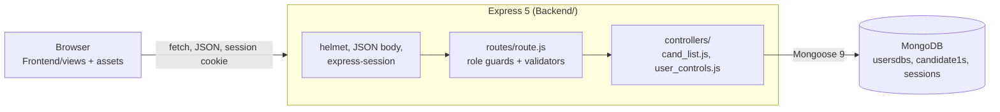

# e-Ballot (AP-Project)

An online ballot for electing **batch representatives** at a university. An
election office (admin) puts candidates on the ballot for each intake batch;
students register with their roll number, see only the candidates standing for
their own batch, and cast exactly one vote. Results show the leader of every
batch, with ties reported as ties.

This started in 2019 as **AP-Project**, a four-person university group project
built on Node.js, Express and MongoDB. The original API proposal planned the
endpoints that still exist today (`/login`, `/voter/castVote`,
`/admin/addCandidate` and so on). The code has since been brought up to date:
current Express and Mongoose, real per-user sessions, input validation, tests,
a purpose-built browser client and a Docker setup.



## What it does

- **Voters** register (name, roll number, batch, password), sign in, mark one
  box on their batch's ballot paper and cast it. They can follow the standings,
  edit their profile, change their password or delete their account (which
  withdraws their vote).
- **Admins** add and remove candidates, filter the list by batch, look up voters
  by name or roll number, delete voter accounts and add further admins.
- **Results** group candidates by batch, show each tally and mark the winner,
  or every leader when there is a tie. A batch with no votes has no winner.

| Results (desktop) | Results (mobile) | Election office |
| --- | --- | --- |
|  |  |  |

All names in the screenshots come from the fictional seed data.

## Running it

### With Docker Compose (recommended)

```sh
cp .env.example .env        # then set SESSION_SECRET to a long random string
docker compose up --build -d --wait
docker compose run --rm -e NODE_ENV=development app node scripts/seed.js   # optional demo data
```

Open <http://localhost:3000>. With the demo data you can sign in as
`ADMIN-01` (election office) or as voter `22F-1004`, both with the password
`ballot-demo-pass`. The seed script wipes users and candidates first and refuses
to run when `NODE_ENV=production`, which is why the command above overrides it.

Stop everything with `docker compose down` (add `-v` to drop the database volume).

### Without Docker

You need Node.js 22 (see `.nvmrc`) and a MongoDB server.

```sh
cd Backend
npm ci
export MONGODB_URI=mongodb://localhost:27017/eballot
npm run seed      # optional demo data
npm start         # http://localhost:3000
```

| Variable | Default | Purpose |
| --- | --- | --- |
| `MONGODB_URI` | `mongodb://localhost:27017/eballot` | Database connection |
| `SESSION_SECRET` | dev-only fallback; **required** when `NODE_ENV=production` | Signs the session cookie |
| `PORT` | `3000` | Listen port |
| `COOKIE_SECURE` | `false` | Set `true` when served over HTTPS |
| `TRUST_PROXY` | unset | Express `trust proxy` setting behind a reverse proxy |
| `LOGIN_RATE_LIMIT` | `20` | Sign-in and sign-up attempts per IP per 15 minutes |

### Tests and lint

The suite uses `node:test` and supertest against a real MongoDB. Each test file
creates and drops its own database.

```sh
docker run -d --rm --name eballot-test-db -p 27017:27017 mongo:7
cd Backend
MONGODB_URI=mongodb://localhost:27017 npm test   # 27 tests
npm run lint
docker stop eballot-test-db
```

## How it is put together



```
Backend/
  server.js               connects to MongoDB, starts the HTTP server
  app.js                  middleware, static files, routes, error handler
  app_server/models       Mongoose schemas (field names kept from 2019)
  app_server/controllers  request handlers
  app_server/middleware   auth guards, validators, response envelope
  app_server/routes       URL map (paths follow the original proposal)
  scripts/seed.js         fictional demo election
  test/                   node:test + supertest suites
Frontend/
  views/                  index, ballot, results, admin and profile pages
  assets/                 one stylesheet, a small fetch client, page scripts
```

## API

Every response uses the envelope from the original proposal,
`{ "status", "data", "message" }`, and the HTTP status matches `status`.
Requests send JSON bodies. Routes under `/voter` need a signed-in voter;
routes under `/admin` need an admin.

| Method and path | Who | Purpose |
| --- | --- | --- |
| `POST /signup` | anyone | Register a voter and sign in |
| `POST /login`, `POST /signout` | anyone | Start or end a session |
| `GET /session` | anyone | The signed-in user, or `null` |
| `GET /voter/homepage` | voter | Candidates in the voter's batch |
| `GET /voter/view_candidate_list` | voter | All candidates |
| `GET /voter/search_Candidate/:query` | voter | Name search (case-insensitive, literal) |
| `PATCH /voter/castVote` | voter | `{ "roll": "<candidate roll>" }` |
| `GET /voter/results`, `GET /admin/results` | both | Standings and winners per batch |
| `PUT /voter/UpdateProfile`, `PATCH /voter/changePassword` | voter | Profile and password (`current_password`, `password`) |
| `DELETE /voter/deactivate_account` | voter | Delete own account and withdraw the vote |
| `POST /admin/addCandidate`, `DELETE /admin/deletecandidate/:roll` | admin | Manage the ballot |
| `GET /admin/view_candidate_list/filter?batch=2022` | admin | Candidates of one batch |
| `GET /admin/viewVotes/:candidate` | admin | One candidate's vote count |
| `GET /admin/searchvoterUname/:query`, `GET /admin/searchvoterRoll/:query` | admin | Find voters |
| `DELETE /admin/deletevoter/:roll` | admin | Delete a voter and withdraw their vote |
| `POST /admin/add_admin` | admin | Create another admin |

Captured from the Compose stack with the demo data:

```http
POST /login
{"roll_number":"22F-1004","password":"ballot-demo-pass"}

200 {"status":200,"data":{"_id":"6af2ec98c67476e7f33bdff1","username":"Iqra Basit","roll_number":"22F-1004","Batch":2022,"type":true,"role":"voter","hasVoted":false},"message":"signed in"}
```

```http
PATCH /voter/castVote
{"roll":"22F-2002"}

200 {"status":200,"data":{"roll_num":"22F-2002","username":"Usman Tariq"},"message":"vote recorded"}

PATCH /voter/castVote      (same voter again)
409 {"status":409,"data":null,"message":"you have already voted"}
```

```http
GET /voter/results

200 {"status":200,"data":[{"batch":2022,"totalVotes":3,
     "winners":[{"username":"Hira Qadeer","roll_num":"22F-2001","votes":2}],
     "standings":[{"username":"Hira Qadeer","roll_num":"22F-2001","votes":2}, ...]}, ...],
     "message":"found"}
```

## Design notes

- **One vote, enforced in the database.** Casting a vote is a conditional
  update that only succeeds while the voter's `votedFor` is empty, so parallel
  requests cannot vote twice. Deleting a candidate voids their ballots so those
  voters can vote again; deleting a voter withdraws their vote.
- **Secret ballot.** Responses never include `votedFor`, only `hasVoted`, and
  password hashes are never serialised.
- **Injection-safe queries.** Validators reject any non-string value before it
  reaches a query, and Mongoose's `sanitizeFilter` neutralises stray `$`
  operators as a second line of defence. Search text is regex-escaped.
- **Sessions instead of tokens.** Sessions live in MongoDB (`connect-mongo`), the
  cookie is `HttpOnly` and `SameSite=Lax`, the session id is regenerated on
  sign-in, and the API only accepts JSON bodies, which keeps state-changing
  requests same-site. Sign-in and sign-up are rate limited.
- **No build step for the client.** The pages are plain HTML, CSS and `fetch`,
  served by Express under a strict Content Security Policy (no inline scripts).
- **2019 field names kept.** `roll_num`, `College`, `Batch`, `type` (true for
  voters) and the route paths match the original schema and proposal, so data
  from the first version still loads.

## Credits

AP-Project was built in 2019 by a team of four students as a university group
project. The original project proposal (a Word document with the planned API
table) is not included in the repository.

Released under the [MIT License](LICENSE).
